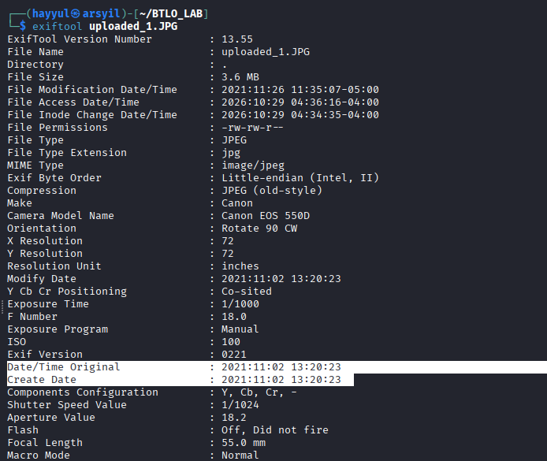
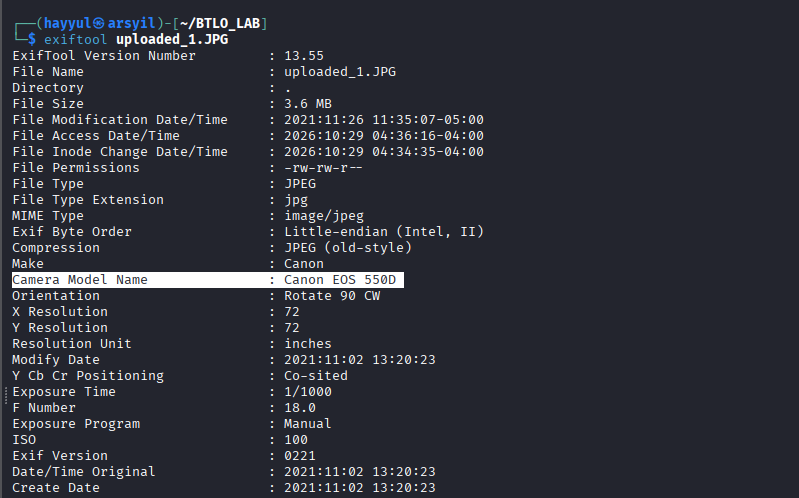
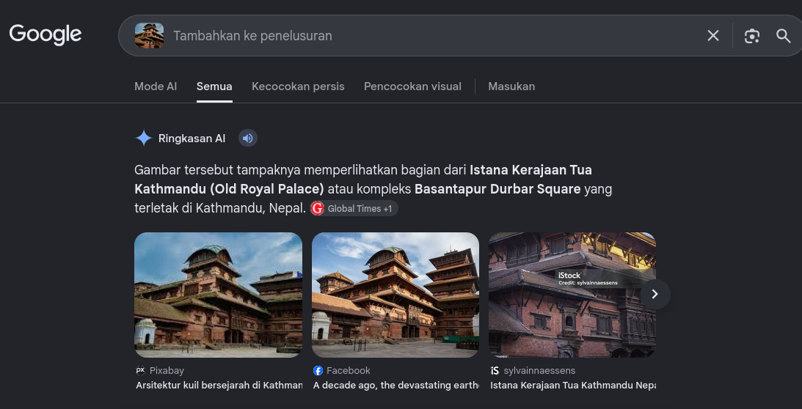

# META - Blue Team Labs Online (Write Up)

Blue Team Labs Online (BTLO) adalah platform latihan keamanan defensif dari Security Blue Team. Challenge **Meta** berfokus pada analisis metadata OSINT: dari dua gambar seorang penjahat, kita diminta menggali informasi yang tidak terlihat langsung digambar.

## Skenario

Gambar-gambar terlampir diposting oleh seorang penjahat dalam pelarian, dengan judul "Saya bebas berkeliaran. Kau tidak akan pernah menangkapku". Kami yakin Anda dapat membantu kami membuktikan bahwa dia salah.

## Tools

Kita akan menggunakan tool :

1. Exiftool
2. Reverse Image

**Apa model kameranya?**

Disini saya akan menggunakan tool Exiftool untuk mengekstrak metadata gambar. Ada 2 gambar yang diberikan oleh challenge yaitu uploaded_1.jpg dan uploaded_2.png, disini kita akan gunakan uploaded_1.jpg 

Perintah : exiftool uploaded_1.jpg

**Kapan gambar itu diambil?**

Masih di Metadata uploaded_1.jpg disini kita akan cari waktu gambar diambil coba perhatikan pada bagian Date/Time Original & Create Date.

**Apa komentar pada gambar pertama mengatakan?**

Masih di Metadata yang sama disini kita akan cari comment yang ada pada gambar uploaded_1.jpg, scrool sampai menemukan bagian comment.

**Di mana penjahatnya?**

Untuk bagian ini kita akan menggunakan tool Google Reverse Image, perlu diketahui disini kita gunakan file gambar uploaded_2.png karena gambar tersebut berisi sebuah tempat. Tinggal upload gambarnya pada tool tersebut maka hasilnya akan memberikan info detail terkait gambar tersebut berada.

## Kesimpulan

Hal yang bisa kita pelajari adalah dari dua gambar saja metadata dan pencarian gambar sudah cukup untuk mengungkap perangkat yang dipakai, waktu pengambilan, catatan tersembunyi, dan lokasi. Satu foro yang diunggah tanpa membersihkan metadata bisa membocorkan informasi yang tidak disadari pemiliknya.

## Referensi
[Challenge Link](https://blueteamlabs.online/home/challenge/meta-b976cec9e2)

