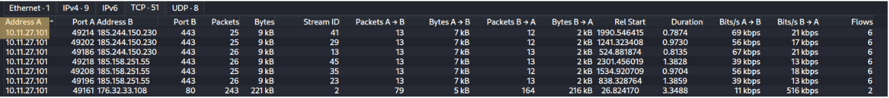
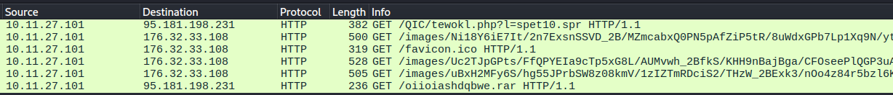
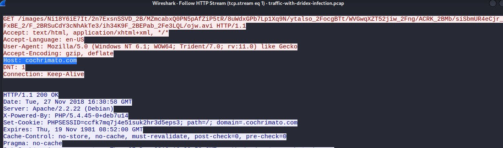
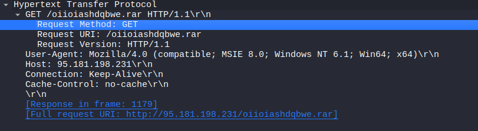
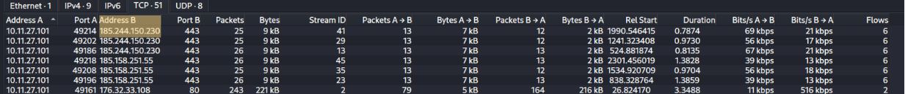

# Network Analysis – Malware Compromise

## Skenario

Seorang Analis SOC di Umbrella Corporation sedang memeriksa peringatan SIEM dan melihat peringatan untuk koneksi ke domain berbahaya yang dikenal. Lalu lintas tersebut berasal dari komputer Sara, seorang Akuntan yang menerima banyak email dari pelanggan setiap hari. Melihat log gateway email untuk kotak surat Sara, tidak ada yang mencurigakan, dengan email yang berasal dari pelanggan. Sara dihubungi melalui teleponnya dan dia menyatakan bahwa seorang pelanggan mengiriminya faktur yang berisi dokumen dengan makro, dia membuka email tersebut dan programnya mengalami crash. Tim SOC mengambil PCAP untuk analisis lebih lanjut.

## Tools
Kita akan menggunakan wireshark untuk challenge ini untuk membuka dan menjalankan file pcap.

**Berapakah IP pribadi dari host yang terinfeksi ?**

Pada bagian pertama ini kita bisa menemukan IP nya dengan klik tab statistic --> conversation. Setelah di halaman conversation klik tab IPv4 dan urutkan dengan klik address A disana kita bisa temukan IP dari host yang terinfeksi.

**Apa jenis binary malware yang coba diambil oleh dokumen makro tersebut ?**

Pada bagian ini kita cari dengan menggunakan filter masukan http.request.method == "GET". Setelah paket ditampilkan perhatikan dibagian info disana ada info GET  /QIC dan perhatikan value nama parameter GET.

**Dari domain mana permintaan HTTP dengan GET /images/ berasal ?**

Masih di filter http.request.method == "GET" perhatikan paket yang infonya mengandung /image ada 3 paket pilih salah satu kemudian klik kanan follow --> http stream perhatikan pada bagian host.

**Tim SOC menemukan Dridex, malware lanjutan dari infeksi Ursnif, sebagai pelakunya. Pelanggan yang mengirimkan file makro tersebut telah terinfeksi. Apa URL lengkap yang berakhiran .rar tempat Ursnif mengambil malware lanjutan tersebut ?**

Masih dengan filter http.request.method == "GET" perhatikan bagian info paket yang mengandung file .rar lalu klik dan di paket detail dibawah perhatikan dibagian detail http --> Get disana ada teks yang berwarna biru yaitu full request URI itulah URL nya.

**Berapakah alamat IP lalu lintas pasca-infeksi Dridex yang diawali dengan 185 ?**

Pada bagian ini kita hapus filter sebelumnya dan setelah bersih buka tab statistic --> conversation setelah masuk klik tab address A untuk mengurutkan paket terbesar lalu perhatikan di address B maka itulah IP lalu lintas pasca-infeksi dridex.

## Referensi
[Challenge Link](https://blueteamlabs.online/home/challenge/network-analysis-malware-compromise-e882f32908)

