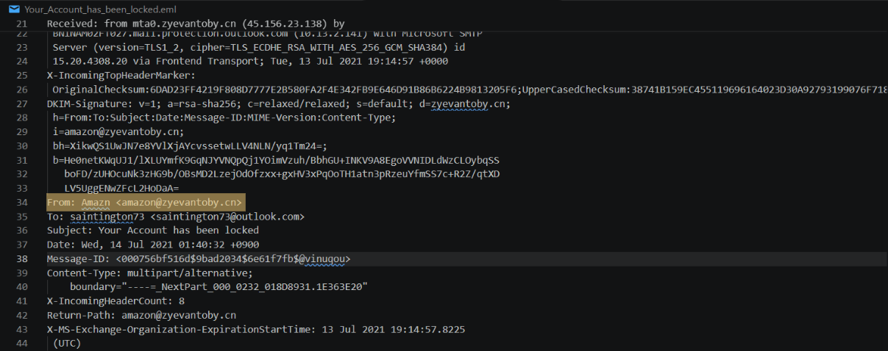
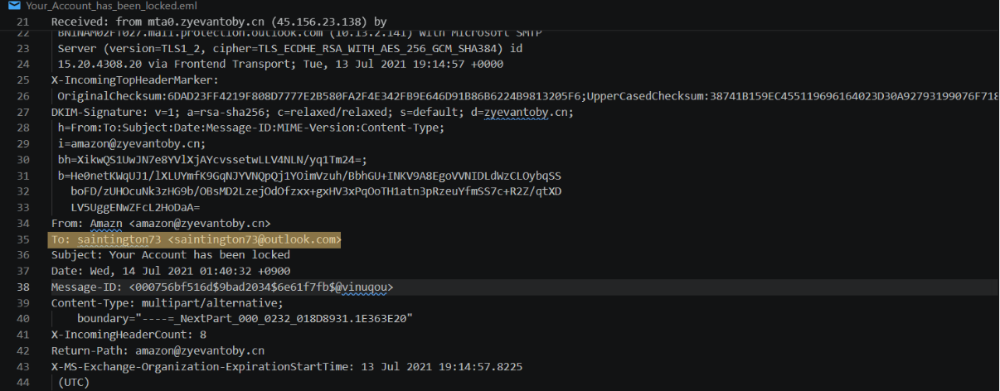
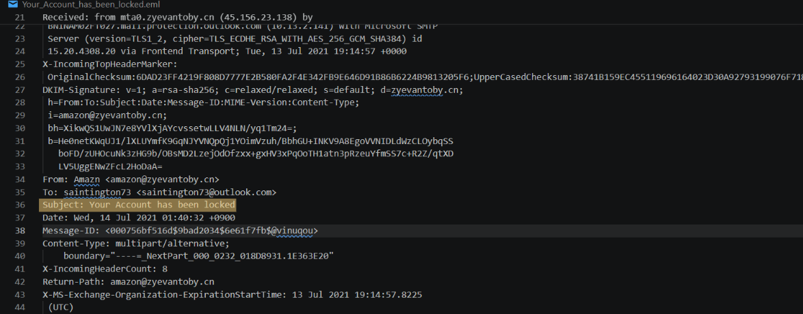
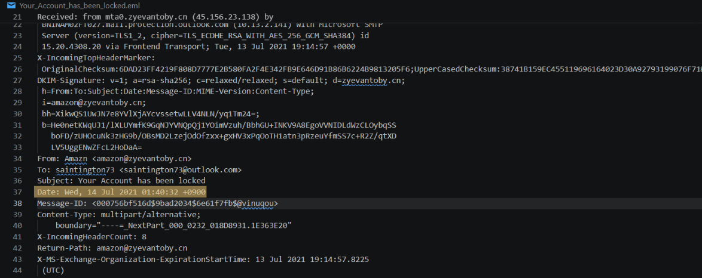
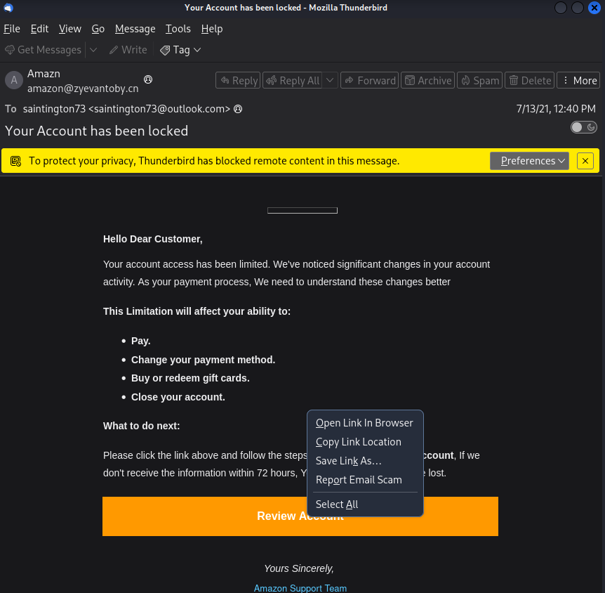
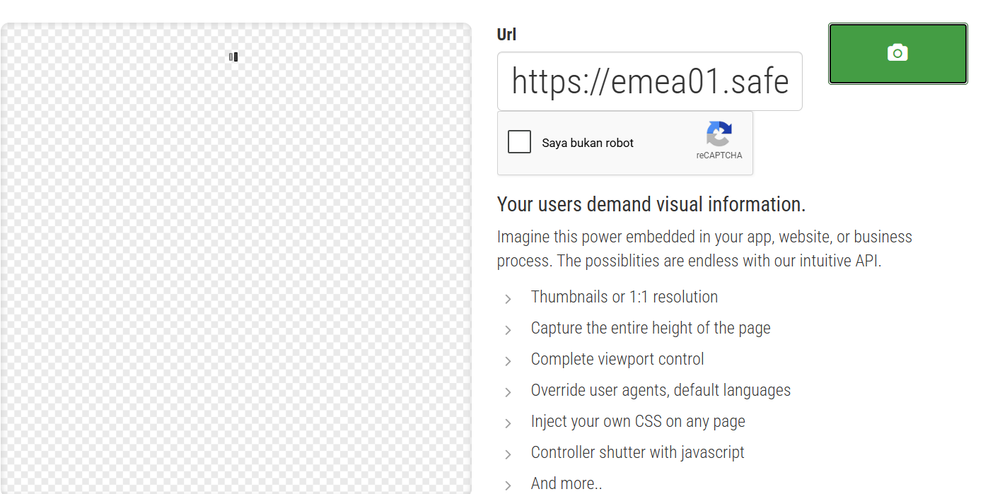
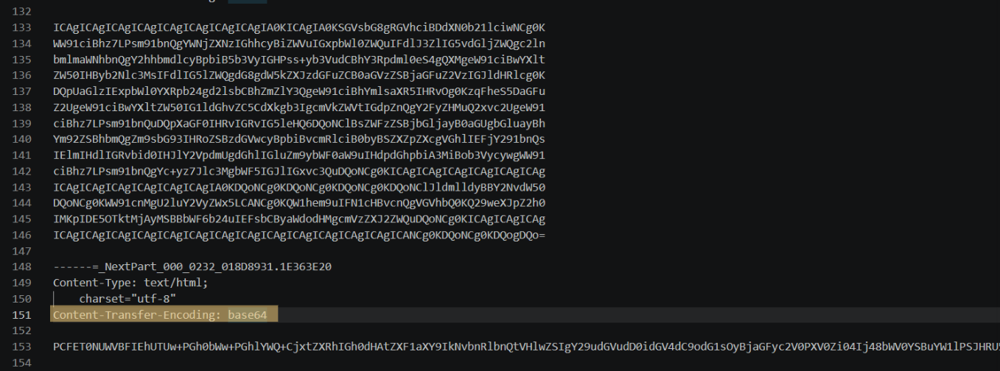
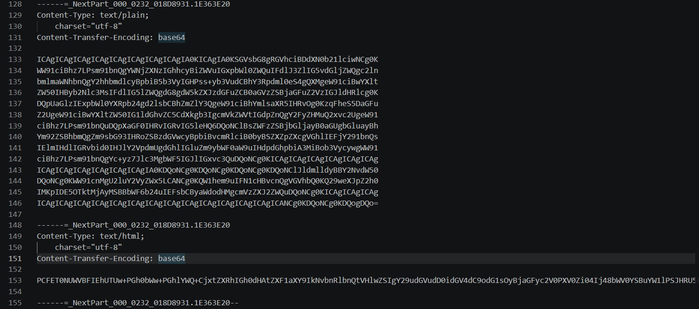
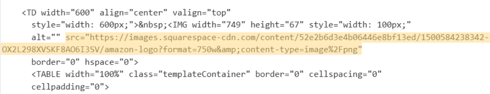
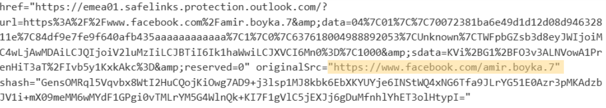

## Analisis Phising 2

# Skenario
Uji kemampuan analisis phishing Anda dengan melakukan triase dan mengumpulkan informasi tentang kampanye phishing terbaru.

# Tools
Kita akan menggunakan Thunderbird sebagai klien email kita dan untuk mengambil artefak email, kita akan menggunakan editor teks bernama Visual Studio Code

1. Editor Teks (Visual Studio Code)

2. Mozilla Thunderbird

3. CyberChef

**1. Alamat email pengirim:**
Saat kita membuka email di Text editor, kita dapat mencari "From" menggunakan find (CTRL+F).

**2. Alamat email penerima?**
Dengan menggunakan Text editor, kita dapat mencari kata “To” menggunakan Find (CTRL+F).

**3. Subject email?**
Untuk pertanyaan ini, kita akan mencari di bagian header “Subject” atau cari kata "Subject" menggunakan find (CTRL+F).

**4. Perusahaan yang coba ditiru oleh penyerang?**
Berdasarkan alamat di bagian header "From", kita dapat melihat bahwa penyerang menyamar sebagai perusahaan Amazon.

**5. Tanggal dan waktu email tersebut dikirim?**
Untuk pertanyaan ini, kita akan mencari dibagian header Date “Date” atau cari kata "Date" menggunakan find (CTRL+F).

**6. Apa URL dari tombol ajakan bertindak utama (call-to-action-button)?**
Untuk mendapatkan tautan URL berbahaya dari email phishing, kita perlu mengklik kanan tautan tersebut dan memilih "Salin Lokasi Tautan" dengan hati-hati. Harap dicatat bahwa ada risiko yang terlibat saat menggunakan metode ini karena Anda mungkin secara tidak sengaja membuka tautan berbahaya tersebut. Sebagai alternatif, Anda dapat menggunakan editor teks.

**7. Lihat URL menggunakan URL2PNG. Apa kalimat pertama (judul) yang ditampilkan di situs ini? (terlepas dari apakah Anda berpikir situs tersebut berbahaya atau tidak)**
Untuk pertanyaan ini, kita perlu menyalin URL di atas dan menempelkannya ke https://www.url2png.com/.

**8. Saat melihat isi utama teks di editor teks, skema pengkodean apa yang digunakan?**
Untuk pertanyaan ini, kita akan mencari kolom “Encoding” atau kita dapat mencari dengan find (CTRL+F) dan masukkan kata "Encoding".

**9. Apa URL yang digunakan untuk mengambil logo perusahaan di email?**
Untuk pertanyaan ini, kita akan menyalin konten Base64 dan menempelkannya ke CyberChef untuk dianalisis seperti yang ditunjukkan di bawah ini.

Selanjutnya dibagian output cyberchef cari bagian 'http' 'https' lalu biasanya diikuti images.

**10. Karena alasan yang tidak diketahui, salah satu URL berisi URL profil Facebook. Berdasarkan URL tersebut, apa nama pengguna (tidak harus nama tampilan) dari akun ini?**
Untuk pertanyaan ini, kita akan mencari kolom “facebook” di bagian Output pada CyberChef pada kode yang tadi yang kita decode.

# Referensi
[Challenge Link](https://blueteamlabs.online/home/challenge/phishing-analysis-2-a1091574b8)

