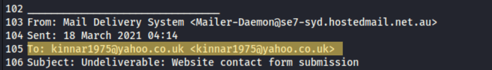
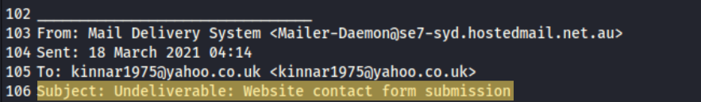
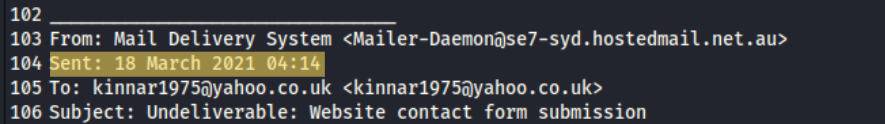
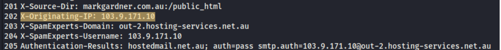
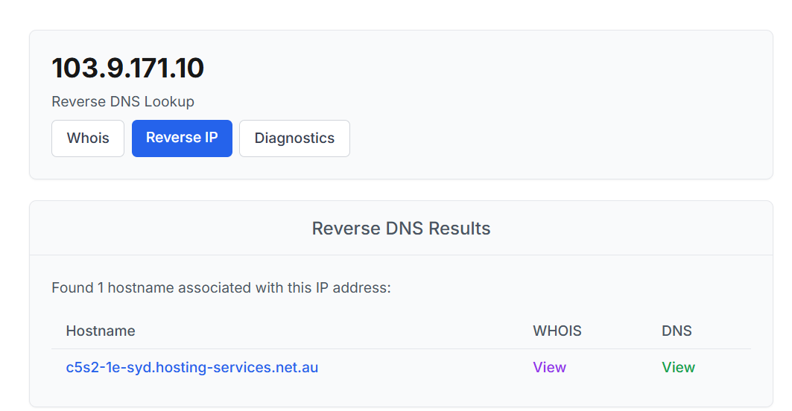
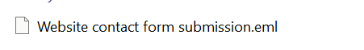
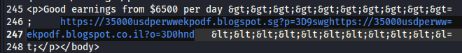
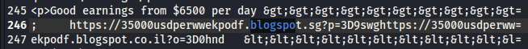
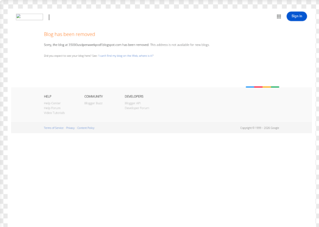

# Analisis Phising

## Skenario
Seorang pengguna telah menerima email phishing dan meneruskannya ke SOC. Dapatkah Anda menyelidiki email dan lampirannya untuk mengumpulkan artefak yang berguna?

## Tools
1. WHOIS
2. URL2PNG
3. Text Editor

**1. Penerima Utama:**

Untuk penerima ini tercantum di header 'To:' konteksnya email ini dikirim ke siapa dan apakah email ini menargetkan satu orang atau bagian dari campaign massal.

**2. Subjek:**

Subjek ini memberi kesan email berasal dari layanan atau kegiatan apa. Ini taktik social engineering supaya korban merasa email ini wajar dan segera untuk membukanya.

**3. Tanggal & Waktu:**

Tercatat di header date, date adalah waktu penyerang mengirim email ke target.

**4. Originating IP:**

IP ini diambil dari header 'Received:', yaitu server hosting yang mengirim email ke server surat atau bisa kita temukan di header X-Originating-IP. Itu IP server pengirim, bukan IP pelaku.

**5. Reverse DNS:**

Buka https://who.is masukkan Originating IP nya dan klik search setelah muncul whois information selanjutnya klik tab reverse IP, maka Hasilnya satu hostname yaitu server hosting pengirim email.

**6. Nama Lampiran:**

ini bisa kita temukan pada nama file yang kita download dari challenge dan sudah kita ekstrak (.eml).

**7. URL di dalam lampiran:**

URL ini adalah tujuan korban setelah membuka lampiran.

**8. Layanan Hosting:**

Layanan hosting bisa kita temukan pada URL tadi karena layanan menempel dengan URL tersebut. Penyerang sering memakai layanan sah atau gratis agar domainnya tidak langsung masuk daftar blokir, dan agar mudah dibuat ulang bila hapus.

**9. Heading Halaman:**

Heading ini adalah tampilan pertama yang dilihat korban. Konteksnya halaman menyamar sebagai sebuah merk/layanan dan data apa yang diminta.

## Referensi
[Challenge Link](https://blueteamlabs.online/home/challenge/phishing-analysis-f92ef500ce)

